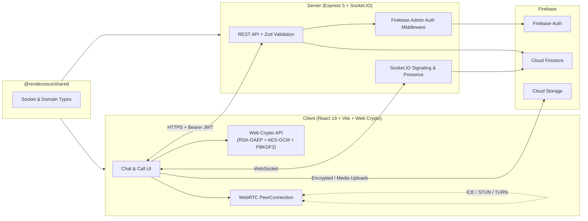

# Rendezvous

A real-time, end-to-end encrypted (E2EE) messaging and peer-to-peer WebRTC audio/video calling platform built with TypeScript, React 19, Express 5, Socket.IO, and Firebase.

## Architecture



## Key Features

- **End-to-End Encryption (E2EE):** Native browser Web Crypto API (`RSA-OAEP` 2048-bit SHA-256 + `AES-GCM` 256-bit) with passphrase-protected private key wrapping via `PBKDF2` (100,000 iterations).
- **Real-Time Messaging:** Direct messages and multi-channel group chats over Socket.IO with cursor-based message pagination (`limit` & `before` cursor) and multi-session user socket tracking.
- **Peer-to-Peer Audio & Video Calls:** WebRTC signaling (`call-offer`, `call-answer`, `ice-candidate`) with configurable STUN/TURN servers and graceful media/ICE error handling.
- **File & Media Attachments:** Client-side MIME/extension allowlist (blocking active web scripts such as `.html`, `.js`, `.svg`, `.sh`), 10 MB size limit, and Firebase Storage rules.
- **Internationalization (i18n):** English (`en`, default) and Spanish (`es`) UI translations with an in-app language switcher.
- **Type-Safe Monorepo:** Shared Socket.IO event contracts and domain models in `@rendezvous/shared`.

## Monorepo Structure

```text
Rendezvous/
├── client/             # React 19 + TypeScript + Vite + Tailwind CSS v4 frontend
├── server/             # Express 5 + Socket.IO + TypeScript backend
├── shared/             # @rendezvous/shared TypeScript contracts & interfaces
├── docs/               # Security & Firestore schema documentation
├── .github/workflows/  # GitHub Actions CI pipeline
├── firestore.rules     # Cloud Firestore security rules
├── storage.rules       # Firebase Storage security rules
├── netlify.toml        # Netlify frontend deployment config
└── render.yaml         # Render backend deployment config
```

## Prerequisites

- **Node.js** >= 20
- **npm** >= 10
- A **Firebase** project with Authentication, Cloud Firestore, and Cloud Storage enabled

## Quick Start

1. **Install dependencies** from the repository root:

   ```bash
   npm install
   ```

2. **Build the shared workspace** (required before typechecking or running `client` / `server`):

   ```bash
   npm run build:shared
   ```

3. **Configure environment variables:**

   - Copy `server/.env.example` to `server/.env` and fill in your Firebase Admin credentials and `CORS_ORIGIN`.
   - Copy `client/.env.example` to `client/.env` and fill in your Firebase Web SDK keys and `VITE_SERVER_URL` (plus optional `VITE_TURN_*` credentials).

4. **Run in development mode** (in two terminals):

   ```bash
   npm run dev:server
   npm run dev:client
   ```

## Workspace Scripts

| Script | Description |
| --- | --- |
| `npm run dev:server` | Start the Express + Socket.IO server in watch mode |
| `npm run dev:client` | Start the Vite development server |
| `npm run build` | Build `shared`, `server`, and `client` for production |
| `npm run typecheck` | Run `tsc --noEmit` across all workspaces |
| `npm run lint` | Run ESLint on the `client` workspace |
| `npm test` | Run Vitest unit and Supertest integration suites |

## Documentation

- [Client Workspace Guide](./client/README.md)
- [Server Workspace Guide](./server/README.md)
- [Security & E2EE Architecture](./docs/SECURITY_ARCHITECTURE.md)
- [Security Policy](./SECURITY.md)
- [Firestore Data Model](./docs/FIRESTORE_SCHEMA.md)

### Cross-Platform `package-lock.json` & Native Binaries Note

Tailwind CSS v4 (`@tailwindcss/oxide`) and `lightningcss` rely on platform-specific optional native binaries (e.g., `win32-x64-msvc` on Windows vs. `linux-x64-gnu` on Linux). Because npm's optional dependency resolution can omit Linux native bindings when a lockfile is generated on Windows, `.github/workflows/ci.yml` and `netlify.toml` perform a clean `rm -f package-lock.json && npm install` on Linux builders so platform-native binaries are always resolved cleanly without drift.

## License

This project is licensed under the [MIT License](./LICENSE).
